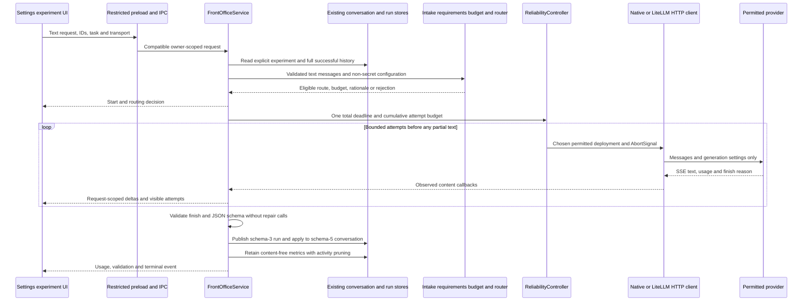
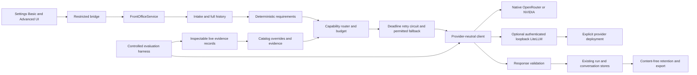

# Implemented request flows

Experimental chat is opt-in in Settings → LLM Backend / Front Office. The normal agent research path continues to use its existing context, policies, tools/planners and manual settings. The experiment path is explicit and context-free; it never calls the context orchestrator.

Normal agent chat still flows through ChatService → context orchestrator → existing provider adapter → existing response validation/run store. Its passive baseline observer records before-provider-translation estimates and per-call timings without changing model choice. Those runs use mode existing-agent-baseline and are not confused with context-free A experiments.

No Next API server, new conversation database, hosted telemetry, agent classifier or automatically launched Python service is added. The optional proxy process is externally managed. Cancellation shares existing owner-scoped admission; stale renderer events are ignored by request ID. Closing Settings stops its active experiment.

See [module contracts](02-modules-and-contracts.md), [providers](03-provider-setup-openrouter-nvidia.md), [ranking](04-model-registry-and-ranking.md), [budgets](05-token-economics-and-context.md), [reliability](06-reliability-errors-and-recovery.md), [metrics/evaluation](07-observability-and-benchmark.md), [tuning](08-front-office-tuning-playbook.md) and [rollback](09-security-and-rollback.md).
