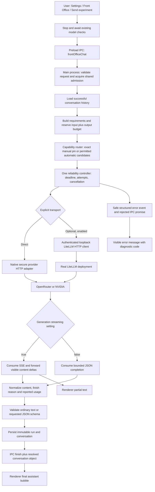

# Provider request flow — QT-RCA-001

QTerminal is a static Next.js renderer inside Electron. There is no separate Next API server in the production chat path. The preload bridge exposes narrow IPC methods; only Electron main reads encrypted provider credentials or calls provider HTTP endpoints.

## What each boundary means

The experiment panel is the existing basic, context-free chat path. It sends the question and complete successful local conversation history. It does not inject a system persona, Context Box, skills, retrieval, tools or persistent memory. The ordinary Agent Chat path still requires its existing agent/context binding and retains its existing prompt policy.

`useChatRuntime.prepareBasicChat` coordinates the experiment panel with the normal runtime. Normal model checks also use the shared ChatService admission slot. An explicit experiment operation cancels checks and awaits their cleanup before attempting creation, configuration or generation. It does not cancel an unrelated active agent generation. Actual conflicts still fail visibly.

`request-intake.cjs` validates the caller's narrow request. `conversation-manager.cjs` retains successful user/assistant turns, rather than silently trimming history. Requirements and token budget modules estimate input, reserve the requested output and verify advertised capacity and optional cost caps. Estimates do not become provider-reported usage.

`model-router.cjs` records selection reasons, warnings and candidate rejections. A manual conversation stays pinned; it cannot silently switch providers/models. Automatic routing and fallback require explicit policy. Supported output-cap keywords are `max_tokens` and `max_completion_tokens`. If a catalog advertises only the latter, the gateway sends that keyword with the same hard cap. Temperature, capability, provider consent and budget checks still apply.

`reliability.cjs` owns all experimental retries. It enforces one cumulative deadline, maximum attempts, circuit cooldown and cumulative reservations. It does not retry after visible partial output. Authentication/invalid-request failures are not transient retry candidates. Cross-provider fallback and switching logical models have separate consent controls.

`provider-gateway.cjs` performs one inference call per attempt. Direct calls reuse the existing secure provider adapter without the normal agent envelope. LiteLLM is an optional external, authenticated loopback service; QTerminal neither installs nor starts it. A successful mocked loopback response does not verify an actual LiteLLM installation.

SSE consumption distinguishes visible `delta.content` from reasoning or metadata, assembles split UTF-8 events, retains trailing usage, and requires completion. Non-streaming consumption parses a bounded JSON message (string or text-array content), retains finish/usage/reasoning counts, and does not invent deltas or time-to-first-token. Empty, refused or incomplete content fails output validation rather than appearing as a successful blank answer.

The renderer shows partial text during streaming, then uses the resolved persisted conversation for the final assistant bubble. A safe structured error event preserves its diagnostic code even when Electron drops custom properties from the rejected Error crossing `contextBridge`. Provider bodies, authorization headers and keys never become UI diagnostics.

## Trace interpretation

Every accepted experiment uses one request ID in IPC events, backend stages and diagnostic DOM observations. Run IDs identify immutable local records. Stage metadata contains timestamps, elapsed milliseconds, known provider/model IDs, counts, status and safe error codes; it does not contain prompts, generated private text or headers.

Expected successful sequence:

`REQUEST_RECEIVED → REQUEST_VALIDATED → MODEL_CANDIDATES_EVALUATED → MODEL_SELECTED → GATEWAY_REQUEST_STARTED → PROVIDER_RESPONSE_RECEIVED → STREAM_STARTED (streaming only) → FIRST_CONTENT_RECEIVED → RESPONSE_NORMALIZED → OUTPUT_VALIDATED → FRONTEND_RESPONSE_DELIVERED → REQUEST_COMPLETED`.

The durable backend trace ends before persistence/rendering and labels that timing boundary. The diagnostic runner appends `FRONTEND_RESPONSE_DELIVERED` only after observing the actual final assistant DOM. IPC dispatch alone is not proof of rendering. F captures retain backend stages and separate successful DOM observations with the same per-turn request ID and actual frontend timestamps.

Missing stages have explicit interpretations: direct Test A bypasses routing/context/UI; non-streaming omits `STREAM_STARTED`; a preflight rejection never reaches transport; an HTTP/network timeout never reaches normalization or rendering. Early IPC admission rejection happens before a run observer exists and is captured as a separate UI admission observation. These are not successful stages or swallowed responses. The first error stage is retained even if later completion/error bookkeeping occurs. A recovered fallback may therefore have a first failed stage while the overall run succeeds.
